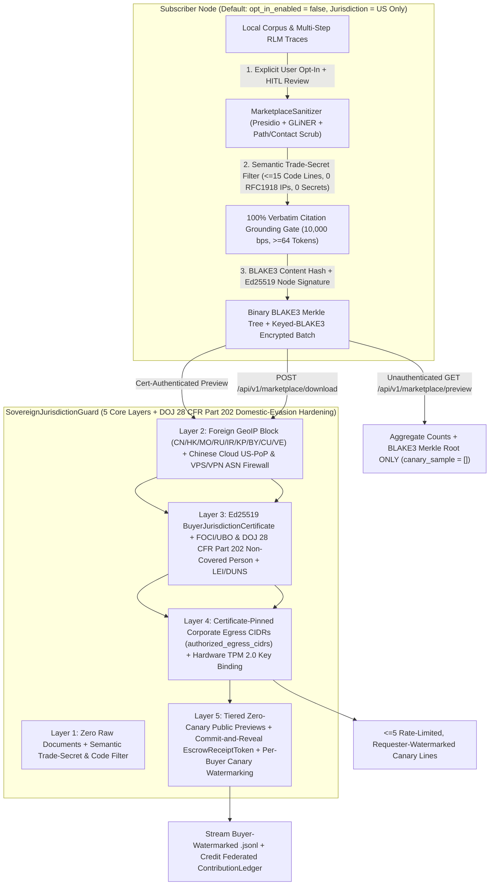

# QuorumRAG

[](https://github.com/oyesanyf/QuorumRAG/releases)
[](https://github.com/oyesanyf/QuorumRAG/actions/workflows/quorumrag-release.yml)
[](https://github.com/oyesanyf/QuorumRAG/actions/workflows/raptor-security.yml)

Production-grade, local-first, peer-to-peer Retrieval-Augmented Generation (RAG) and Recursive Language Model (RLM) daemon with an embedded ChatGPT-style Web UI, co-located hybrid vector/full-text search, and cryptographic privacy enforcement.

- **Hybrid Search Engine**: LanceDB dense vector embeddings paired with co-located Tantivy BM25 full-text indexing, evaluated via Reciprocal Rank Fusion (RRF) and parent-document window expansion.
- **Multimodal Ingestion**: Documents (PDF, DOCX, XLSX, PPTX, TXT, MD), images (local Ollama vision captioning), and audio, with magic-byte exclusion of binaries and executables (`.exe`, `.dll`, ELF, Mach-O).
- **100% Verbatim Citation Grounding**: LLM synthesis and deterministic offline synthesis verify `slice_text.contains(&verbatim_quote)` on every cited excerpt.
- **Ed25519-Authenticated `libp2p` Mesh**: Cryptographically signed scatter-gather retrieval across private LAN/WAN peers with Microsoft Presidio + GLiNER (`urchade/gliner_multi_pii-v1`) HIPAA PHI/PII Data Loss Prevention (DLP).
- **Structured Peer Query Diagnostics**: Real-time reporting of connected swarm nodes, queried peers, and per-peer outcomes (status, chunk count, cited count, timeout, policy blocks) rendered directly in the Web UI.
- **Zero-Stub Production Architecture**: Single self-contained binary daemon that automatically binds open ports, manages local indexes, and launches the browser interface.

---

## Contents

- [Quickstart & Install](#quickstart--install)
- [Architecture & Data Flow](#architecture--data-flow)
- [CLI Reference](#cli-reference)
- [Build from Source](#build-from-source)
- [Workspace Layout](#workspace-layout)
- [Repository Map](#repository-map)
- [Opt-In Sovereign AI Training Data Marketplace (Experimental)](#opt-in-sovereign-ai-training-data-marketplace-experimental)
- [Documentation](#documentation)

---

## Quickstart & Install

Download pre-built packages from [Releases](https://github.com/oyesanyf/QuorumRAG/releases). Every package installs QuorumRAG as an always-on background service and opens `http://127.0.0.1:3031/` in your browser:

| OS | Package | Service Name |
|---|---|---|
| Windows | `QuorumRAG-<ver>-x86_64.msi` (or portable `.zip`) | `QuorumRAGDaemon` |
| Debian / Ubuntu | `quorumrag_<ver>_<arch>.deb` | `quorumrag.service` |
| RHEL / Fedora / SUSE | `quorumrag-<ver>-1.<arch>.rpm` | `quorumrag.service` |
| macOS | `QuorumRAG-<ver>-macos-universal.pkg` | `dev.quorumrag.daemon` |
| Docker | `ghcr.io/oyesanyf/quorumrag:latest` | Container daemon |

### Docker Container

```bash
docker run -d --name quorumrag --network host \
  -v quorumrag-data:/var/lib/quorumrag \
  ghcr.io/oyesanyf/quorumrag:latest

# Web UI: http://127.0.0.1:3031/
```

### Running the Daemon Locally

If running from binary or cargo:

```bash
# Start daemon with default fixed-drive indexing and browser launch
quorumrag --host 0.0.0.0 --port 3031 --p2p-port 3032 --data-dir ./data

# Or headless without auto-opening browser
quorumrag --no-browser --data-dir ./data
```

Uninstalling stops the service and deletes installed files. See [docs/INSTALL.md](docs/INSTALL.md) for silent-install switches, data paths, purge options, and code-signing notes.

---

## Architecture & Data Flow

QuorumRAG coordinates embedded local storage, ingestion watchers, language model synthesis, and decentralized swarm peers:

```
[User / Browser]
       │
       ▼ (HTTP / SSE / WebSocket)
[quorum-ui / Axum Web Server] (Embedded HTML/CSS/JS, SSE Streaming, Citations)
       │
       ▼
[quorum-coordinator] ─── (400ms scatter-gather) ───┐
       │                                            ▼
       ├─────────────────────────┐          [quorum-network] (rust-libp2p Swarm)
       ▼                         ▼                  │ (QUIC/TCP/Noise/Yamux/mDNS/CBOR)
[quorum-storage]          [quorum-contract]         ▼
(LanceDB + Tantivy FTS)   (Gemma 768d Offline)   [Remote Peer Swarm Nodes]
  - Arrow Encapsulated     - Deterministic B3       - Ed25519 Access Tier Pre-filter
  - SQL Pre-filtering        contract hash          - ZeroizeOnDrop Remote Chunks
  - Scheduled Compaction   - Constant-time gating   - Reciprocal Rank Fusion (RRF)
       ▲
       │ (Micro-batched writes)
[quorum-ingest]
  - Google Magika Content-Type Sniffing
  - Level-1 BLAKE3 Mtime Catalog
  - Level-2 BLAKE3 Chunk Hash Cache
  - Multimodal Vision / Audio Extraction
```

### Core Invariants

1. **Deterministic Offline Fallback**: If no local Ollama or cloud LLM engine is running, `DeterministicOfflineSynthesisEngine` synthesizes cohesive biographical and technical answers with full citation links.
2. **Volatile Memory Protection**: Remote chunks ingested from the P2P mesh implement `ZeroizeOnDrop` to prevent cross-peer retention in process memory.
3. **Fail-Closed Access Tiers**: Document chunks and search queries enforce Ed25519-signed `AccessTier` gates (`Tier0Public`, `Tier1Internal`, `Tier2Confidential`, `Tier3Restricted`).

---

## CLI Reference

```
Usage: quorumrag [OPTIONS] [COMMAND]

Commands:
  reindex    Run standalone reindex worker process on designated directories
  fix-drift  Run standalone drift healing process repairing all 5 drift types
  recache    Invalidate, synchronize, and pre-warm BLAKE3 query and embedding caches
  watch-p2p  Run dedicated out-of-process P2P Mesh Watcher & Self-Healing Supervisor
  help       Print this message or the help of the given subcommand(s)

Options:
  -p, --port <PORT>
          Port to bind the web server and UI on [default: 3030]
      --host <HOST>
          Host interface to bind on [default: 0.0.0.0]
      --data-dir <DATA_DIR>
          Root directory for LanceDB and Tantivy persistent data [default: ./data]
      --watch-dir <WATCH_DIR>
          Directory to index and watch for changes (defaults to all fixed physical drives)
      --no-browser
          Do not auto-open the default browser upon server startup
      --p2p-port <P2P_PORT>
          Port for libp2p P2P swarm (TCP & QUIC) [default: 3031]
      --local-only
          Run in local-only mode (disable remote peer networking)
      --no-p2p-watcher
          Disable spawning the dedicated out-of-process P2P watcher child process
      --model-family <MODEL_FAMILY>
          Default synthesis model family [default: AutoFusion]
      --max-peer-responses <MAX_PEER_RESPONSES>
          Maximum number of remote peer responses to collect/fuse per query [default: 8]
      --service
          Run under the OS Service Control Manager (file logging to <data-dir>/logs/)
  -h, --help
          Print help
  -V, --version
          Print version
```

### CLI Subcommands

- **`quorumrag reindex --path <DIR> [--full] [--force-reembed] [--batch-size 64]`**:
  Executes an offline reindex pass using Level-1 mtime and Level-2 BLAKE3 caching.
- **`quorumrag fix-drift [--dry-run] [--drift-type <TYPE>]`**:
  Audits and heals storage drift across Merkle state, hybrid index desync, vector contracts, ACL policies, and compaction.
- **`quorumrag recache [--clear] [--warm]`**:
  Pre-warms hot vector queries or flushes the embedding cache epoch.
- **`quorumrag watch-p2p [--daemon-url <URL>] [--interval-secs 10] [--heal-service] [--once]`**:
  Monitors mesh connectivity and automatically restarts the local service daemon on stalls.

---

## Build from Source

Prerequisites: Rust stable toolchain (`1.78+`), CMake, and LLVM/Clang for LanceDB C++ dependencies.

```bash
# Build release daemon
cargo build --release -p quorum-daemon --bin quorumrag

# Run release executable
./target/release/quorumrag --host 0.0.0.0 --port 3031 --p2p-port 3032 --data-dir ./data
```

### Package Generation

- **Windows MSI**: `powershell -ExecutionPolicy Bypass -File scripts/package.ps1`
- **Linux DEB / RPM**: `packaging/linux/build_packages.sh`
- **macOS Universal PKG**: `packaging/macos/build_packages.sh`

---

## Workspace Layout

| Crate | Purpose |
|---|---|
| `quorum-daemon` | HTTP API, embedded Web UI, SQLite chat history, Windows service host (`quorumrag` binary) |
| `quorum-coordinator` | Agentic RLM retrieval, answer synthesis, Reciprocal Rank Fusion, Presidio/GLiNER DLP, and `SovereignJurisdictionGuard` |
| `quorum-ingest` | Filesystem discovery, Magika MIME detection, chunking, and multimodal extraction |
| `quorum-storage` | LanceDB vector store and Tantivy BM25 full-text index |
| `quorum-network` | Ed25519-authenticated `libp2p` peer mesh (TCP, QUIC, Noise, Yamux, mDNS) |
| `quorum-contract` | Shared data contracts, BLAKE3 Merkle trees, embedding schemas, and marketplace models |
| `quorum-types` | Core domain types, DocumentChunk, ScoredChunk, AccessTier, and FederatedPeerDiagnostics |
| `quorum-ui` | Embedded HTML, CSS, JavaScript frontend assets and Axum static routes |

---

## Repository Map

| Path | What is there |
|---|---|
| [`crates/`](crates) | Rust workspace crates (see [Workspace layout](#workspace-layout)) |
| [`crates/quorum-daemon/src/`](crates/quorum-daemon/src) | HTTP handlers, CLI router, shutdown signals, Windows service harness (`win_service.rs`) |
| [`crates/quorum-coordinator/src/`](crates/quorum-coordinator/src) | Answer orchestrator, offline engine, scatter-gather, DLP mesh, and sovereign marketplace engine |
| [`crates/quorum-ui/assets/`](crates/quorum-ui/assets) | Embedded responsive ChatGPT-style Web UI (`index.html`, `app.js`, `styles.css`) |
| [`crates/quorum-network/src/`](crates/quorum-network/src) | Libp2p Swarm, Noise authentication, Ed25519 request signing, and peer discovery |
| [`crates/quorum-storage/src/`](crates/quorum-storage/src) | Embedded LanceDB vector tables and Tantivy full-text search indexes |
| [`crates/quorum-ingest/src/`](crates/quorum-ingest/src) | Google Magika content detector, multithreaded crawler, and document chunkers |
| [`packaging/windows/`](packaging/windows) | Launcher scripts, browser launcher, and complete-uninstall utilities for MSI |
| [`packaging/linux/`](packaging/linux) | deb/rpm builders, systemd unit file (`quorumrag.service`), and control helper |
| [`packaging/macos/`](packaging/macos) | pkg/dmg builders, LaunchDaemon plist, install and uninstall scripts |
| [`wix/QuorumRAG.wxs`](wix/QuorumRAG.wxs) | WiX v5 MSI definition (auto-start service, browser launch, clean removal) |
| [`scripts/`](scripts) | Packaging pipeline (`package.ps1`), solo PR ship script, and nightly RAPTOR security audit |
| [`.github/workflows/`](.github/workflows) | Multi-platform CI, release builders, PR invariant gate, and RAPTOR security scans |
| [`docs/`](docs) | Detailed guides for installation, multimodal ingestion, and sovereign data marketplace |
| [`AGENTS.md`](AGENTS.md) | Boundary and solo-developer shipping invariants for automated agents |

---

## Opt-In Sovereign AI Training Data Marketplace (Experimental)

> [!IMPORTANT]
> **Strictly Disabled by Default (`opt_in_enabled = false`) & `["US"]`-Only Default Sovereign Lock**:
> Every marketplace endpoint (`/api/v1/marketplace/harvest`, `/approve-batch`, `/preview`, `/unlock`, `/download`, `/bounties`, `/pool-merge`, `/ledger`) ships **OFF by default** and returns `403 Forbidden` unless the local node owner explicitly turns on **Opt-In AI Training Data Marketplace** in Settings and clicks **Approve & Seal Batch (HITL)**. Out of the box, `allowed_jurisdictions` defaults strictly to `["US"]` (`US_ONLY_DOJ_28_CFR_PART_202`).

The Sovereign AI Training Data Marketplace allows opted-in subscribers to monetize sanitized, citation-grounded SFT and DPO reasoning trajectories with verified domestic AI labs while enforcing a multi-layer anti-exfiltration and domestic-evasion guard (`SovereignJurisdictionGuard`).



### 4-Stage Sovereign Pipeline

1. **Stage 1 -- Local Privacy Scrubbing, Trade-Secret Filtering & Quality Attestation**:
   Automated PII/PHI de-identification via Presidio Analyzer and GLiNER, zero raw file leakage, semantic code filters (rejects trajectories with `> 15` code lines or high-entropy secrets), and 10,000 bps (100.00%) citation grounding verification.
2. **Stage 2 -- Zero-Knowledge Data Catalog Manifests**:
   Signed Ed25519 manifests containing record counts, verified token volume, and binary BLAKE3 Merkle roots. Tiered anti-scraping prevents mass harvesting.
3. **Stage 3 -- Commit-and-Reveal Cryptographic Escrow**:
   Batches are encrypted at rest with a keyed BLAKE3 stream cipher in `marketplace_ledger.db`. Unlocking requires verified certificates and constant-time token MAC validation.
4. **Stage 4 -- Federated Swarm Pool & Revenue Splits**:
   Peer nodes pool sanitized records across the libp2p mesh (`POST /api/v1/marketplace/pool-merge`), deduplicate canonical record hashes, and compute exact basis-point revenue allocations via `ContributionLedger`.

### Five-Layer Sovereign Guard Matrix

| Guard Layer | Threat Vector Blocked | Technical Enforcement |
|---|---|---|
| **Layer 1: Zero Raw Documents & Semantic Filter** | Accidental data harvesting, PII/PHI leakage, proprietary code | `opt_in_enabled = false` default (`403 Forbidden`); Presidio + GLiNER scrubbers; trade secret rejection filter ([`marketplace_engine.rs`](crates/quorum-coordinator/src/marketplace_engine.rs)). |
| **Layer 2: GeoIP + ASN Proxy Firewall** | Adversary connections (`CN`, `HK`, `MO`, `RU`, `IR`, `KP`, etc.) and datacenter VPN proxies | Blocks foreign adversary CIDRs and `HIGH_RISK_DATACENTER_PROXY_ASNS` (Alibaba Cloud, Tencent Cloud, Huawei, China Telecom, DigitalOcean, Vultr, Linode, OVH, Hetzner, etc.). |
| **Layer 3: Buyer Jurisdiction Certificate & FOCI/UBO** | Shell companies or adversary-controlled subsidiaries | Requires authority-signed `Ed25519` `BuyerJurisdictionCertificate` with non-covered-person attestation (DOJ 28 CFR Part 202) and verified LEI/DUNS identifier. |
| **Layer 4: Pinned Egress CIDRs & TPM 2.0 Binding** | Proxy forwarding and cluster credential relaying | Validates caller IP against pinned corporate CIDRs and matches hardware `bound_tpm_pubkey_blake3` via constant-time comparison. |
| **Layer 5: Escrow Receipts & Canary Watermarking** | Dataset reconstruction and unauthorized redistribution | Rate-limited previews; commit-and-reveal escrow tokens; deterministic buyer watermarking (`compute_buyer_watermark_hex`) for leak attribution. |

Run marketplace security verification tests:

```bash
cargo test -p quorum-contract -p quorum-coordinator --lib marketplace
cargo test -p quorum-daemon --test marketplace_sovereign_escrow_tests
```

---

## Documentation

- [docs/INSTALL.md](docs/INSTALL.md): Service installation, silent unattended flags, uninstall, purge, and code-signing details.
- [docs/MULTIMODAL.md](docs/MULTIMODAL.md): Image, audio, and document ingestion, OCR extraction, and multimodal synthesis.
- [docs/SOVEREIGN_MARKETPLACE.md](docs/SOVEREIGN_MARKETPLACE.md): Comprehensive reference for Sovereign Marketplace, Escrow, and 5-Layer Jurisdiction Guard.
- [AGENTS.md](AGENTS.md): Strict solo-developer shipping workflow, repository boundary rules, and RAPTOR security gates.
