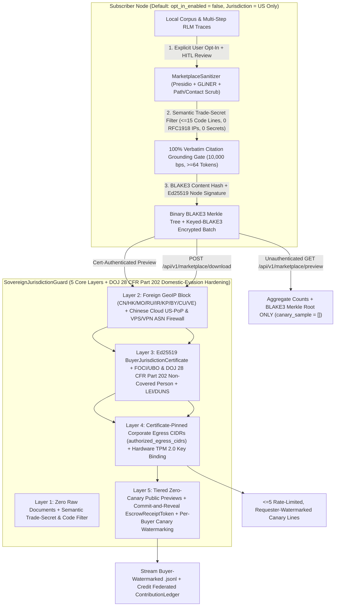

# QuorumRAG

[](https://github.com/oyesanyf/QuorumRAG/releases)
[](https://github.com/oyesanyf/QuorumRAG/actions/workflows/quorumrag-release.yml)
[](https://github.com/oyesanyf/QuorumRAG/actions/workflows/raptor-security.yml)

Local-first, peer-to-peer agentic Retrieval-Augmented Generation (RAG) and Recursive Language Model (RLM) daemon with an embedded ChatGPT-style Web UI and an **Opt-In Sovereign AI Training Data Marketplace** (strictly disabled by default: `opt_in_enabled = false`).

- **Hybrid Search & Deep Parent-Window RLM**: LanceDB dense vectors + Tantivy BM25 full-text search with `0..10000` byte parent-document window expansion and cross-node document-family deduplication.
- **Multimodal Ingestion**: Documents (PDF, DOCX, XLSX, PPTX, TXT, MD), images (local Ollama vision captioning), and audio, with magic-byte exclusion of executables/binaries (`.exe`, `.dll`, ELF, Mach-O).
- **100% Verbatim Citation Grounding**: LLM synthesis and deterministic LangExtract fallback verify `slice_text.contains(&verbatim_quote)` on every citation.
- **Ed25519-Authenticated `libp2p` Mesh**: Cryptographically signed scatter-gather retrieval with Microsoft Presidio + GLiNER (`urchade/gliner_multi_pii-v1`) HIPAA PHI/PII Data Loss Prevention (DLP).
- **Opt-In Sovereign AI Training Data Marketplace & `ContributionLedger`**: Enables subscribers who explicitly opt in to monetize sanitized, citation-grounded SFT and DPO reasoning trajectories with verified U.S. / allied AI labs while enforcing a multi-layer anti-exfiltration and domestic-evasion guard (`SovereignJurisdictionGuard`).

## Contents

- [Sovereign AI Training Data Marketplace & Multi-Layer Guard](#sovereign-ai-training-data-marketplace--multi-layer-guard)
  - [Architecture Overview](#architecture-overview)
  - [4-Stage Sovereign Marketplace & Revenue-Sharing Pipeline](#4-stage-sovereign-marketplace--revenue-sharing-pipeline)
  - [Five-Layer Sovereign Guard + Domestic U.S. Evasion Hardening](#five-layer-sovereign-guard--domestic-us-evasion-hardening)
  - [Code Inspection Map & One-Command Verification](#code-inspection-map--one-command-verification)
- [Install](#install)
- [Build from source](#build-from-source)
- [Workspace layout](#workspace-layout)
- [Repository map](#repository-map)
- [Documentation](#documentation)

---

## Sovereign AI Training Data Marketplace & Multi-Layer Guard

> [!IMPORTANT]
> **Strictly Disabled by Default (`opt_in_enabled = false`) & `["US"]`-Only Default Sovereign Lock**:
> Every marketplace endpoint (`/api/v1/marketplace/harvest`, `/approve-batch`, `/preview`, `/unlock`, `/download`, `/bounties`, `/pool-merge`, `/ledger`) ships **OFF by default** and returns `403 Forbidden` unless the local node owner explicitly turns on **Opt-In AI Training Data Marketplace** in Settings and clicks **Approve & Seal Batch (HITL)**. Out of the box, `allowed_jurisdictions` defaults strictly to `["US"]` (`US_ONLY_DOJ_28_CFR_PART_202`).

### Architecture Overview

Frontier AI labs do not buy raw, unverified PDFs or hard-drive dumps due to copyright exposure and PII/PHI liability. They purchase **de-identified, domain-specific SFT (Supervised Fine-Tuning) and DPO (Direct Preference Optimization) reasoning trajectories** that prove how an agentic model solves multi-step problems with 100% verbatim substring grounding.



### 4-Stage Sovereign Marketplace & Revenue-Sharing Pipeline

1. **Stage 1 -- Local Privacy Scrubbing, Trade-Secret Filtering & Quality Attestation ([`MarketplaceSanitizer`](crates/quorum-coordinator/src/marketplace_engine.rs))**:
   - **Automated PII/PHI De-Identification**: Runs `OsoosiMeshDlpController` (Microsoft Presidio Analyzer/Anonymizer + GLiNER `urchade/gliner_multi_pii-v1`) plus deterministic regex scrubbers to strip personal names, emails, phone numbers, SSNs, client identifiers, and Windows/POSIX local file paths (`[REDACTED:PERSON]`, `[REDACTED:EMAIL]`, `[REDACTED:PHONE]`, `[REDACTED:SSN]`, `[REDACTED:LOCAL_PATH]`).
   - **Zero Raw Files & Semantic Trade-Secret Filter (`contains_trade_secret_or_proprietary_code`)**: Raw PDFs, Word documents, and spreadsheets are never exported. Only abstracted RLM reasoning traces (`prompt`, `rlm_trajectory`, `chosen_response`, `rejected_response`) are packaged, and any trajectory containing `> 15` lines of source code, RFC1918/ULA internal IP addresses, `.internal`/`.corp`/`.lan` hostnames, PEM keys, or high-entropy secrets is deterministically rejected before batch sealing.
   - **Cryptographic Quality Attestation (`SanitizedTrainingRecord`)**: Requires `grounding_score_bps == 10_000` (100.00% of citations verified via `slice_text.contains(verbatim_quote)`) and `>= 64` tokens. Each record is hashed with `blake3` (`blake3_record_hash`) and signed with the node's `Ed25519` private key (`origin_node_id`).
2. **Stage 2 -- Zero-Knowledge Data Catalog Manifests ([`DataCatalogManifest`](crates/quorum-contract/src/marketplace.rs))**:
   - Generates an `Ed25519`-signed manifest containing domain tags, SFT/DPO record counts, total verified token volume, and the binary `blake3` Merkle tree root (`compute_blake3_merkle_root`) over all record hashes in the batch.
   - **Anti-Scraping Tiered Previews**: Unauthenticated calls to `GET /api/v1/marketplace/preview` return aggregate counts and `merkle_root_blake3` **only** (`canary_sample: []`). Viewing up to `5` canary sample lines requires a valid `BuyerJurisdictionCertificate`, is rate-limited per buyer and `/24` (or `/48` IPv6) subnet (`429 Too Many Requests`), and embeds a requester-specific watermark into every canary line.
3. **Stage 3 -- Commit-and-Reveal Cryptographic Escrow ([`EscrowReceiptToken`](crates/quorum-contract/src/marketplace.rs)) & Active Data Bounties ([`DataBountySpec`](crates/quorum-contract/src/marketplace.rs))**:
   - Approved `.jsonl` batches are encrypted at rest in `<data_dir>/marketplace_ledger.db` using a keyed BLAKE3 XOF stream cipher + 256-bit keyed MAC (`encrypt_batch_bytes` / `decrypt_batch_bytes`).
   - Verified buyers unlock batches via `POST /api/v1/marketplace/unlock`, which validates all sovereign guard layers and seals an `EscrowReceiptToken` with a 256-bit keyed BLAKE3 MAC verified in constant time (`subtle::ConstantTimeEq`) on `/api/v1/marketplace/download`.
4. **Stage 4 -- Federated Swarm Pool & Revenue-Sharing Ledger ([`ContributionLedger`](crates/quorum-contract/src/marketplace.rs))**:
   - Individual nodes can pool sanitized trajectories across the `libp2p` mesh (`POST /api/v1/marketplace/pool-merge`) to fulfill enterprise-scale training contracts (e.g., 50,000+ SFT/DPO trajectories).
   - `ContributionLedger::merge_and_deduplicate_mesh_records` deduplicates pooled records across peers by canonical `blake3_record_hash`, tracks each peer's unique accepted records and dropped duplicates, and computes exact basis-point (`10,000 bps` = `100.00%`) revenue splits and cent payouts per `origin_node_id`.

### Five-Layer Sovereign Guard + Domestic U.S. Evasion Hardening

To prevent both direct foreign scraping and **domestic U.S. evasion** (where a foreign adversary rents an AWS/DigitalOcean VM in `us-east`, uses a U.S. residential proxy, or registers a Delaware LLC majority-owned by an overseas parent company in violation of the U.S. DOJ Bulk Sensitive Data Rule, **28 CFR Part 202**), `SovereignJurisdictionGuard` enforces the following defense-in-depth controls before a single byte of `.jsonl` data is previewed or unlocked:

| Guard Layer | Threat Vector Blocked | Cryptographic / Network Enforcement in Code |
|---|---|---|
| **Layer 1: Zero Raw Documents, HITL Opt-In & Semantic Trade-Secret Filter** | Accidental background harvesting, PII/PHI leakage, or exfiltration of proprietary source code / internal network topology | `opt_in_enabled = false` default (`403 Forbidden`); `MarketplaceSanitizer` scrubs PII/PHI/paths via Presidio + GLiNER and blocks trajectories with `> 15` code lines, RFC1918/ULA IPs, `.internal`/`.corp` FQDNs, or high-entropy secrets ([`marketplace_engine.rs`](crates/quorum-coordinator/src/marketplace_engine.rs)). |
| **Layer 2: Foreign GeoIP + Chinese Cloud U.S.-PoP & Anonymous VPS/VPN ASN Firewall** | Direct connections from `CN`, `HK`, `MO`, `RU`, `IR`, `KP`, `BY`, `CU`, `VE` **and** domestic U.S. Points of Presence (PoPs) of Chinese clouds/telecoms or rented anonymous VPS/VPNs | Hard-blocks foreign adversary CIDRs (`FOREIGN_ADVERSARY_IPV4_CIDRS`) and `HIGH_RISK_DATACENTER_PROXY_ASNS`: China Telecom/CTAmericas (`AS4134`, `AS4809`), China Unicom (`AS4837`), China Mobile (`AS9808`), Alibaba Cloud US/Intl (`AS37963`, `AS45102`), Tencent Cloud US/Intl (`AS45090`, `AS132203`), Huawei (`AS55990`, `AS136907`), Baidu (`AS38365`), CERNET (`AS4538`), plus DigitalOcean (`AS14061`), Vultr/Choopa (`AS20473`), Linode (`AS63949`), OVH (`AS16276`), Hetzner (`AS24940`), M247 VPN (`AS9009`), and Datacamp/CDN77 (`AS60068`). |
| **Layer 3: Ed25519 `BuyerJurisdictionCertificate` + FOCI/UBO & DOJ 28 CFR Part 202 Attestation** | Delaware shell LLCs or U.S. subsidiaries controlled by foreign adversary parents (*Covered Persons* under 28 CFR Part 202) | Requires authority-signed `Ed25519` `BuyerJurisdictionCertificate` with verified `lei_or_duns_id`, `incorporation_country_iso` in `allowed_jurisdictions` (default `["US"]`), `foci_ubo_verified_clean == true` (`0%` adversary ownership/board control), `doj_part202_non_covered_person == true`, and `non_redistribution_covenant_accepted == true` ([`marketplace.rs`](crates/quorum-contract/src/marketplace.rs)). |
| **Layer 4: Certificate-Pinned Corporate Egress CIDRs & Hardware TPM 2.0 Cluster Binding** | Attackers renting unvetted U.S. EC2/residential proxy IPs or forwarding a valid U.S. API receipt to an overseas training cluster | Every `BuyerJurisdictionCertificate` cryptographically pins the buyer's static corporate IPv4/IPv6 `authorized_egress_cidrs` (`cidr_contains_ip` checks `caller_ip` and every `X-Forwarded-For` / `CF-Connecting-IP` / `X-Real-IP` hop) and binds `bound_tpm_pubkey_blake3` verified in constant time (`subtle::ConstantTimeEq`) against `X-Quorum-TPM-Pubkey-Blake3`. |
| **Layer 5: Tiered Anti-Scraping Previews, Commit-and-Reveal Escrow & Per-Buyer Canary Watermarking** | Reconstructing datasets by scraping 5-line previews across rotates IPs, or reselling unlocked `.jsonl` batches to third parties | Unauthenticated `/api/v1/marketplace/preview` returns `canary_sample: []` (aggregate counts + `merkle_root_blake3` only); cert-authenticated previews are rate-limited and watermarked; `/api/v1/marketplace/download` verifies `EscrowReceiptToken` keyed BLAKE3 MAC in constant time and embeds deterministic `compute_buyer_watermark_hex` watermarks into every record for leak attribution. |

### Code Inspection Map & One-Command Verification

| Component | Source File | Key Types & Functions |
|---|---|---|
| **Marketplace Contracts, Merkle Root & `ContributionLedger`** | [`crates/quorum-contract/src/marketplace.rs`](crates/quorum-contract/src/marketplace.rs) | `BuyerJurisdictionCertificate`, `EscrowReceiptToken`, `SanitizedTrainingRecord`, `DataCatalogManifest`, `ContributionLedger::merge_and_deduplicate_mesh_records`, `compute_blake3_merkle_root`, `compute_buyer_watermark_hex` |
| **7-Layer Domestic-Evasion Guard & Sanitizer** | [`crates/quorum-coordinator/src/marketplace_engine.rs`](crates/quorum-coordinator/src/marketplace_engine.rs) | `verify_us_sovereign_buyer_against_domestic_evasion`, `HIGH_RISK_DATACENTER_PROXY_ASNS`, `cidr_contains_ip`, `contains_trade_secret_or_proprietary_code`, `MarketplaceSanitizer::sanitize_and_sign_record`, `encrypt_batch_bytes`, `decrypt_batch_bytes` |
| **SQLite Ledger Store & Axum HTTP Routes** | [`crates/quorum-daemon/src/handlers/marketplace.rs`](crates/quorum-daemon/src/handlers/marketplace.rs) | `MarketplaceStore`, `/api/v1/marketplace/status`, `/opt-in`, `/harvest`, `/approve-batch`, `/preview`, `/unlock`, `/download`, `/pool-merge`, `/ledger`, `/bounties` |
| **Embedded Web UI Marketplace Modal** | [`crates/quorum-ui/assets/index.html`](crates/quorum-ui/assets/index.html) | `#modal-marketplace`, `#marketplace-opt-in-toggle` (default `OFF`), `#marketplace-jurisdiction-select` (default `US_ONLY`), `#marketplace-ledger-tbody` |
| **End-to-End Integration Test Suite (6 Tests)** | [`crates/quorum-daemon/tests/marketplace_sovereign_escrow_tests.rs`](crates/quorum-daemon/tests/marketplace_sovereign_escrow_tests.rs) | `test_1_disabled_by_default_invariant` through `test_6_domestic_us_proxy_and_shell_company_evasion_invariant` |

Run all Marketplace unit and end-to-end security invariant tests locally:

```bash
cargo test -p quorum-contract -p quorum-coordinator --lib marketplace
cargo test -p quorum-daemon --test marketplace_sovereign_escrow_tests
```

---

## Install

Download a package from [Releases](https://github.com/oyesanyf/QuorumRAG/releases). Every package installs QuorumRAG as an always-on background service and opens http://127.0.0.1:3031/ in your browser:

| OS | Package |
|---|---|
| Windows | `QuorumRAG-<ver>-x86_64.msi` (service `QuorumRAGDaemon`) or the portable `.zip` |
| Debian / Ubuntu | `quorumrag_<ver>_<arch>.deb` (`quorumrag.service`) |
| RHEL / Fedora / SUSE | `quorumrag-<ver>-1.<arch>.rpm` (`quorumrag.service`) |
| macOS | `QuorumRAG-<ver>-macos-universal.pkg` (LaunchDaemon `dev.quorumrag.daemon`) |
| Docker (linux/amd64, linux/arm64) | `ghcr.io/oyesanyf/quorumrag:latest` from [GitHub Packages](https://github.com/oyesanyf/QuorumRAG/pkgs/container/quorumrag) |

Container:

```bash
docker run -d --name quorumrag --network host \
  -v quorumrag-data:/var/lib/quorumrag \
  ghcr.io/oyesanyf/quorumrag:latest
# Web UI: http://127.0.0.1:3031/   (remove with: docker rm -f quorumrag && docker volume rm quorumrag-data)
```

Uninstalling stops the service and deletes it completely. See [docs/INSTALL.md](docs/INSTALL.md) for silent-install options, data locations, purge options and code-signing notes.

## Build from source

```bash
cargo build --release -p quorum-daemon --bin quorumrag
./target/release/quorumrag --host 0.0.0.0 --port 3031 --p2p-port 3032 --data-dir ./data
```

Windows installers: `powershell -ExecutionPolicy Bypass -File scripts/package.ps1`.
Linux and macOS packages: `packaging/linux/build_packages.sh` and `packaging/macos/build_packages.sh`.

## Workspace layout

| Crate | Purpose |
|---|---|
| `quorum-daemon` | HTTP API, embedded Web UI, SQLite Marketplace & Chat stores, Windows service entry point (`quorumrag` binary) |
| `quorum-coordinator` | Agentic RLM retrieval, answer synthesis, `SovereignJurisdictionGuard`, `MarketplaceSanitizer`, and Presidio/GLiNER DLP |
| `quorum-ingest` | Parallel filesystem discovery, parsing, authorship metadata, and multimodal extraction |
| `quorum-storage` | LanceDB vector store and Tantivy BM25 full-text index |
| `quorum-network` | Ed25519-authenticated `libp2p` peer mesh |
| `quorum-contract` | Shared embedding, RLM, `DataCatalogManifest`, `BuyerJurisdictionCertificate`, `EscrowReceiptToken`, and `ContributionLedger` contracts |

## Repository map

| Path | What is there |
|---|---|
| [`crates/`](crates) | Rust workspace crates (see [Workspace layout](#workspace-layout)) |
| [`crates/quorum-contract/src/marketplace.rs`](crates/quorum-contract/src/marketplace.rs) | Sovereign Marketplace schemas, Ed25519 certificate/manifest signing, BLAKE3 Merkle trees, and `ContributionLedger` |
| [`crates/quorum-coordinator/src/marketplace_engine.rs`](crates/quorum-coordinator/src/marketplace_engine.rs) | `SovereignJurisdictionGuard`, domestic-evasion CIDR/ASN/FOCI/Part-202/TPM checks, trade-secret filter, and `MarketplaceSanitizer` |
| [`crates/quorum-daemon/src/handlers/marketplace.rs`](crates/quorum-daemon/src/handlers/marketplace.rs) | SQLite `MarketplaceStore` and `/api/v1/marketplace/*` handlers |
| [`crates/quorum-daemon/tests/marketplace_sovereign_escrow_tests.rs`](crates/quorum-daemon/tests/marketplace_sovereign_escrow_tests.rs) | End-to-end integration tests for disabled-by-default, foreign & domestic evasion blocking, PII/trade-secret scrubbing, escrow, and revenue splits |
| [`crates/quorum-daemon/src/`](crates/quorum-daemon/src) | HTTP handlers, CLI, shutdown, Windows service (`win_service.rs`) |
| [`crates/quorum-coordinator/src/`](crates/quorum-coordinator/src) | Agentic retrieval, `answer_orchestrator.rs`, LangExtract grounding, Presidio/GLiNER DLP |
| [`crates/quorum-ui/assets/`](crates/quorum-ui/assets) | Embedded Web UI |
| [`packaging/windows/`](packaging/windows) | Launcher, open-UI and complete-uninstall scripts for the MSI and ZIP |
| [`packaging/linux/`](packaging/linux) | deb/rpm/tarball builder, `quorumrag.service`, `quorumrag-ctl` helper |
| [`packaging/macos/`](packaging/macos) | pkg/dmg/tarball builder, LaunchDaemon plist, install/uninstall |
| [`wix/QuorumRAG.wxs`](wix/QuorumRAG.wxs) | WiX v5 MSI definition (auto-start service, browser launch, full removal) |
| [`scripts/`](scripts) | `package.ps1` (Windows build), signing, release and PR shipping |
| [`.github/workflows/`](.github/workflows) | Cross-platform installer + release pipeline, PR invariant gate, RAPTOR security scan |
| [`tests/`](tests) | Workspace and end-to-end regression tests |
| [`policy/`](policy) | Witness / supply-chain policy templates |
| [`docs/`](docs) | Install, multimodal, and Sovereign Marketplace documentation |

## Documentation

- [docs/SOVEREIGN_MARKETPLACE.md](docs/SOVEREIGN_MARKETPLACE.md): Sovereign AI Training Data Marketplace, 5-Layer + Domestic-Evasion Guard (`SovereignJurisdictionGuard`), Commit-and-Reveal Escrow, and Federated `ContributionLedger`
- [docs/INSTALL.md](docs/INSTALL.md): service install, silent options, uninstall and purge on every OS, code signing
- [docs/MULTIMODAL.md](docs/MULTIMODAL.md): image/audio/document ingestion, answer orchestration, exports
- [PROJECT.md](PROJECT.md): feature matrix and milestones
- [AGENTS.md](AGENTS.md): rules for automated agents working on this repository
